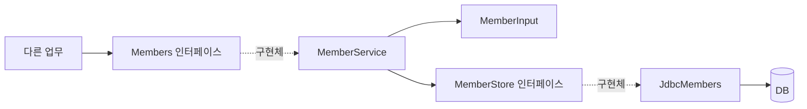
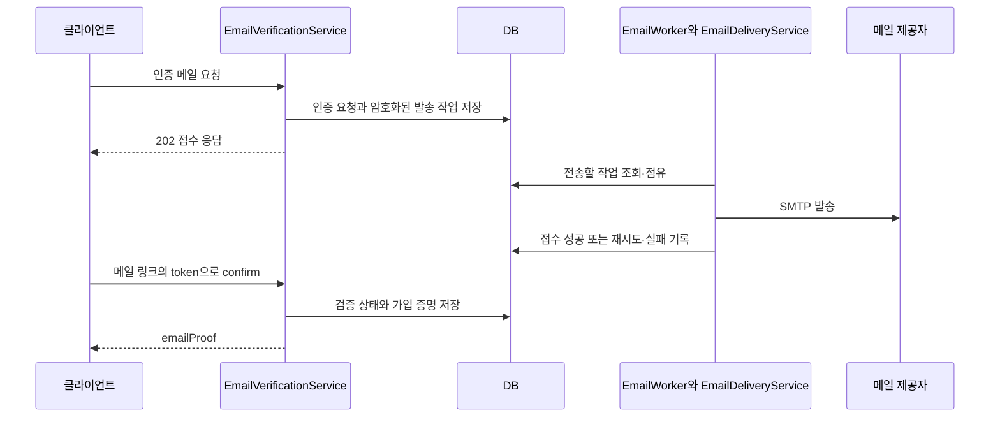

# NOSPO 멀티모듈 코드 공부 가이드

이 문서는 현재 저장소의 이메일 회원가입 구현을 기준으로 작성했다. 멀티모듈을 처음 접한 사람이 실제 코드를 열어 보면서 구조와 실행 흐름을 이해하는 것이 목적이다.

기존 [개발 규칙](NOSPO_Development_Conventions.md)은 프로젝트 전체의 설계 방향을 다룬다. 여기서는 **지금 있는 코드가 어떻게 연결되는지** 설명한다. API 사용법과 실행 환경변수는 [README](../README.md)를 함께 참고한다.

## 1. 먼저 알아둘 핵심

이 프로젝트는 **여러 Gradle 모듈을 하나의 Spring Boot 애플리케이션으로 조립하는 구조**다.

`member`, `identity`, `credit` 폴더마다 서버를 따로 실행하는 것이 아니다. 루트의 `NospoBackendApplication`을 실행하면 필요한 모듈들이 함께 올라간다. 현재 이메일 워커도 같은 애플리케이션 안에서 스케줄러로 실행된다.

```text
하나의 실행 애플리케이션
├── HTTP 요청을 받는 컨트롤러
├── 회원가입 전체 순서를 조정하는 서비스
├── 회원 / 인증 / 약관 / 크레딧 업무 서비스
├── DB 저장 구현
└── 메일 발송 및 주기적 작업
```

이처럼 업무 경계를 나누되 함께 실행하는 구성을 모듈러 모놀리스라고 부를 수 있다. 현재 모듈 사이의 호출은 같은 JVM 안의 Java 메서드 호출이다.

## 2. 폴더는 두 가지 기준으로 나뉜다

`modules/identity/adapter-web`을 예로 보면 다음 두 질문에 대한 답이 경로에 들어 있다.

1. **어느 업무인가?** → `identity`: 이메일 인증과 로그인 자격·세션 관련 업무.
2. **그 업무에서 어떤 역할인가?** → `adapter-web`: HTTP 요청과 내부 기능을 연결하는 역할.

즉, `업무 / 기술적 역할`의 두 축이다. 익숙한 Controller·Service·Repository를 없앤 것이 아니라 업무별로 나누고, 인터페이스를 통해 연결한 것이다.

### 업무별 지도

| 디렉터리 | 현재 책임 | 대표 클래스 |
| --- | --- | --- |
| `member` | 닉네임, 전화번호, 회원 프로필과 상태 | `MemberService`, `JdbcMembers` |
| `identity` | 이메일 인증, 비밀번호 해시, 계정, JWT와 세션, 인증 메일 | `EmailVerificationService`, `SignupIdentityService` |
| `terms` | 현행 약관 조회와 가입 동의 검증·저장 | `TermService` |
| `credit` | 가입 보상 5크레딧 지급 | `SignupCreditService` |
| `account-lifecycle` | 여러 업무를 연결해 회원가입 완료 | `SignupService` |
| `support` | 공통 응답·예외, 암호화, DB 잠금·요청 제한 지원 | `ApiResponse`, `Secrets`, `DatabaseGuard` |

이메일과 비밀번호는 `identity`, 닉네임과 전화번호는 `member`가 맡는다. 같은 회원에 관한 정보라도 책임이 다르다. 여러 업무를 함께 완료해야 하는 회원가입의 전체 순서는 `account-lifecycle`이 맡는다.

### 업무 내부의 역할

| 역할 | 쉬운 설명 | 실제 예 |
| --- | --- | --- |
| `contract` | 다른 업무가 호출할 공개 약속 | `Members`, `SignupIdentity`, `Terms`, `SignupCredits` |
| `domain` | 기술과 무관한 업무 규칙 | `MemberInput`, `EmailAddress` |
| `application` | 기능을 수행하는 순서와 필요한 연결 인터페이스 | `MemberService`, `MemberStore` |
| `adapter-web` | HTTP 요청을 내부 호출로 변환 | `SignupController` |
| `adapter-persistence` | SQL로 DB를 읽고 변경 | `JdbcMembers` |
| `adapter-integration` | 메일·암호 라이브러리 등 외부 기술 연결 | `SmtpEmailSender`, `JwtIdentityCrypto` |
| `adapter-worker` | 주기적으로 기능을 실행하는 입구 | `EmailWorker` |

필요한 역할만 존재한다. 예를 들어 현재 `credit`에는 `domain`이나 `adapter-web`이 없고, `account-lifecycle`에는 `contract`가 없다. 폴더가 빠진 오류가 아니라 현재 기능에 맞춘 구성이다. 현재 domain도 복잡한 엔티티 모델보다는 입력 정규화·검증 클래스 위주다.

## 3. Gradle 모듈이란 무엇인가?

패키지는 Java 코드의 이름과 위치를 구분한다. Gradle 모듈은 **어떤 코드를 함께 컴파일하고, 다른 모듈의 코드를 사용할 수 있는지** 구분한다.

먼저 [settings.gradle](../settings.gradle)을 열어 보자.

```groovy
include ':member:contract'
project(':member:contract').projectDir = file('modules/member/contract')
```

`include`는 Gradle 프로젝트를 등록한다. 두 번째 줄은 논리적 이름 `:member:contract`를 실제 디렉터리에 연결한다. Java의 패키지 이름과 Gradle의 프로젝트 이름은 별개다.

`member`, `identity` 같은 상위 프로젝트도 등록되어 있지만, 실제 Java 코드와 `build.gradle`은 주로 그 아래 역할별 프로젝트에 있다. 상위 프로젝트 이름을 별도 실행 서버로 해석하면 안 된다.

다음으로 [member/application/build.gradle](../modules/member/application/build.gradle)을 보자.

```groovy
dependencies {
    api project(':member:contract')
    implementation project(':member:domain')
    implementation 'org.springframework:spring-context'
}
```

뜻은 다음과 같다.

- application은 contract와 domain의 코드를 사용한다.
- `api` 의존성은 이 모듈을 사용하는 쪽의 컴파일 경로에도 공개된다.
- `implementation` 의존성은 사용하는 쪽의 컴파일 경로에 자동으로 공개하지 않는다. 런타임에 필요 없어지는 뜻은 아니다.
- `spring-context`는 `@Service` 같은 Spring 기능을 사용하기 위한 라이브러리다.

Gradle 의존성에 없는 모듈은 일반적으로 import해서 사용할 수 없다. 다만 `api`를 통해 의존성이 전파될 수 있으므로, 모든 경계 규칙이 Gradle 설정만으로 완벽히 강제된다고 생각하면 안 된다.

[루트 build.gradle](../build.gradle)은 실행에 필요한 모듈들을 `implementation project(...)`로 모으고, Java 21 및 공통 빌드 설정을 제공한다. 루트는 Spring Boot 실행 앱이며, 코드가 있는 하위 프로젝트들은 `java-library`로 구성된다.

## 4. 가장 작은 예제: member를 끝까지 따라가기

다음 네 파일을 순서대로 열면 이 구조의 기본 원리를 볼 수 있다.

1. [Members.java](../modules/member/contract/src/main/java/kr/nospo/member/contract/Members.java)
2. [MemberService.java](../modules/member/application/src/main/java/kr/nospo/member/application/MemberService.java)
3. [MemberStore.java](../modules/member/application/src/main/java/kr/nospo/member/application/MemberStore.java)
4. [JdbcMembers.java](../modules/member/adapter-persistence/src/main/java/kr/nospo/member/persistence/JdbcMembers.java)

### 4.1 contract: 외부에 무엇을 제공하는가?

`Members`는 인터페이스다. `create`, `nicknameAvailable`, `get`, `active`를 공개하고, 결과로 `Profile` record를 사용한다. record는 이 예제에서 여러 값을 묶어 전달하는 데이터 타입이다.

다른 업무는 `Members.create(...)`를 호출하면 된다는 사실만 알면 된다. SQL이나 구체적인 구현 클래스까지 알 필요는 없다. 여기서 contract는 HTTP API 명세가 아니라 **업무 간 Java 호출 규격**이다.

### 4.2 application: 어떤 순서로 수행하는가?

`MemberService implements Members`이므로 공개 약속의 실제 업무 구현체는 `MemberService`다. 회원 생성 시 다음 순서로 처리한다.

```text
닉네임 정규화·검증
→ 비교용 닉네임 키 생성
→ 전화번호 정규화·검증
→ MemberStore.create(...) 호출
```

[MemberInput.java](../modules/member/domain/src/main/java/kr/nospo/member/domain/MemberInput.java)에 규칙이 있다. 닉네임은 앞뒤 공백 제거와 Unicode 정규화를 거치고, 길이·허용 문자를 검증한다. 비교용 키는 소문자로 만든다. 국내 휴대전화 형식은 `+82` 형태로 정규화한다.

### 4.3 Store: 무엇을 저장해야 하는가?

`MemberStore`도 인터페이스다. `MemberService`는 이것을 생성자로 받아 사용한다. 이 인터페이스는 저장 기능을 요청하기 위한 포트, 즉 연결 지점이다.

`Members`와 `MemberStore`는 목적이 다르다.

| 인터페이스 | 사용 주체 | 질문 |
| --- | --- | --- |
| `Members` | 다른 업무 또는 이를 사용하는 코드 | 회원 업무가 어떤 기능을 제공하는가? |
| `MemberStore` | 회원 application | 그 기능 수행에 어떤 저장 작업이 필요한가? |

### 4.4 adapter-persistence: 실제로 어떻게 저장하는가?

`JdbcMembers implements MemberStore`가 `JdbcTemplate`으로 SQL을 실행한다. `create`에서는 UUID를 생성하고 `member` 테이블에 INSERT한다. 닉네임 충돌은 `NICKNAME_ALREADY_EXISTS` 오류로 바꾼다.

루트에 JPA 라이브러리가 있어도 **현재 이 가입 구현의 저장 코드는 JDBC**다. JPA Entity나 Spring Data Repository를 찾는 대신 `Jdbc*` 클래스의 SQL을 읽으면 된다.



그림은 런타임 호출을 설명한다. **소스 의존 방향**으로 보면 `JdbcMembers`가 `MemberStore`를 import하므로 persistence가 application에 의존한다. application은 `JdbcMembers`를 import하지 않는다. 실행 중에는 DB 구현이 호출되지만, 업무 코드가 구체적인 DB 구현을 몰라도 되도록 만든 것이다. 이를 의존성 역전이라고 한다.

## 5. 인터페이스만 받는데 어떻게 실행될까?

[시작 클래스](../src/main/java/kr/nospo/nospo_backend/NospoBackendApplication.java)에는 다음 설정이 있다.

```java
@SpringBootApplication(scanBasePackages = "kr.nospo")
```

실행 클래스가 `kr.nospo.nospo_backend`에 있어도 다른 모듈의 `kr.nospo.member`, `kr.nospo.identity` 등을 검색하도록 범위를 지정했다. 단, 해당 모듈이 실행 클래스패스에 들어 있어야 검색할 수 있다. 루트의 Gradle 의존성이 이를 구성한다.

Spring은 `@Service`, `@Repository`, `@Component` 등의 객체를 관리하고 생성자에 필요한 구현체를 연결한다. 이 객체를 Bean이라고 한다.

```text
SignupService가 Members를 요구
→ MemberService가 Members를 구현하므로 주입

MemberService가 MemberStore를 요구
→ JdbcMembers가 MemberStore를 구현하므로 주입
```

이것이 생성자 주입이다. Gradle은 “코드를 사용할 수 있게” 하고, Spring은 “실행할 객체를 연결”한다. 인터페이스 구현체가 여러 개라면 별도 선택 설정이 필요하지만, 위 예제에는 각각 하나가 있다.

## 6. 실제 회원가입 요청을 따라가기

### 6.1 이메일 인증은 가입 완료와 별도 단계다



[EmailVerificationController](../modules/identity/adapter-web/src/main/java/kr/nospo/identity/web/EmailVerificationController.java)가 HTTP를 받고, [EmailVerificationService](../modules/identity/application/src/main/java/kr/nospo/identity/application/EmailVerificationService.java)가 정규화·요청 제한·재발송 간격·인증 상태를 처리한다.

`token`은 메일 링크를 확인하기 위한 값이고, `emailProof`는 이메일 확인을 마쳤다는 가입용 증명이다. 가입 요청에는 이메일 문자열 대신 이 증명을 보낸다. 현재 둘의 유효시간은 각각 발급 후 10분이다.

발송할 일을 DB에 남겨 두고 나중에 처리하는 구조를 outbox 패턴이라고 한다. [EmailWorker](../modules/identity/adapter-worker/src/main/java/kr/nospo/identity/worker/EmailWorker.java)가 기본 3초 간격의 fixed delay로 [EmailDeliveryService](../modules/identity/application/src/main/java/kr/nospo/identity/application/EmailDeliveryService.java)를 호출한다. 작업 점유를 위한 짧은 트랜잭션을 마친 뒤 SMTP를 호출하고 결과를 별도 트랜잭션으로 기록한다. SMTP 응답을 기다리는 내내 DB 트랜잭션을 유지하지 않는다.

202는 발송 작업 접수이고, `ACCEPTED`는 제공자 접수다. 받은편지함 도착을 보장하는 상태는 아니다. 워커가 재시도하므로 제공자가 접수한 직후 프로세스가 중단되는 경우 등에는 메일이 중복 발송될 가능성도 있다.

### 6.2 가입 완료의 진입점

[SignupController](../modules/account-lifecycle/adapter-web/src/main/java/kr/nospo/lifecycle/web/SignupController.java)의 `signup`을 읽어 보자.

```text
POST /api/v1/auth/signup
→ JSON을 Request record로 변환하고 @Valid 검증
→ HTTP 입력을 SignupService.Command로 변환
→ SignupService.signup(key, command)
→ Access Token을 JSON에, Refresh Token을 HttpOnly 쿠키에 담아 201 반환
```

컨트롤러가 회원 테이블을 직접 변경하지 않는다. HTTP 입력·출력과 쿠키 구성을 맡고, 가입 전체 처리는 서비스에 넘긴다.

### 6.3 가입 순서를 조정하는 SignupService

[SignupService](../modules/account-lifecycle/application/src/main/java/kr/nospo/lifecycle/application/SignupService.java)의 `signup`은 다음 순서로 진행된다.

1. 증명 형식과 동의 목록을 확인한다.
2. 증명 기반 scope와 요청 지문을 계산하고 비밀번호를 해시한다. 비용이 큰 비밀번호 해시는 DB 트랜잭션 밖에서 계산한다.
3. `TransactionTemplate`으로 트랜잭션을 시작한다. 격리 수준은 READ_COMMITTED다.
4. `scope + Idempotency-Key`에 대한 DB 잠금을 얻는다.
5. 저장된 성공 결과가 있으면 요청 지문을 비교하고 최초 결과를 복원한다. 같은 범위·키에서 내용이 다르면 `IDEMPOTENCY_CONFLICT`다.
6. `identity.verifyForSignup`으로 가입 증명의 만료·사용 여부와 이메일 중복을 검사한다.
7. `members.create`로 회원을 만든다.
8. `terms.recordSignup`으로 현행 약관과 필수 동의를 검사하고 동의 이력을 남긴다.
9. `identity.createAccount`로 계정·비밀번호 자격을 만들고 증명을 소비하며 가입 전 자료를 회원에 귀속한다.
10. `credits.grant`로 5크레딧을 지급한다.
11. `identity.openSession`으로 세션과 토큰을 만든다.
12. 성공 응답을 암호화해 멱등 기록에 저장하고 트랜잭션을 완료한다.

여기서 `identity`, `members`, `terms`, `credits` 필드의 타입은 각 업무의 **contract 인터페이스**다. `SignupService`는 다른 업무의 `Jdbc*`를 직접 호출하지 않는다.

### 6.4 왜 하나의 트랜잭션인가?

회원만 생성되고 약관 동의 저장이 실패하거나, 계정은 생성됐는데 보상이 누락되면 가입이 불완전해진다. 현재는 하나의 DB와 같은 트랜잭션 관리 아래 가입 변경을 함께 확정한다. 중간 오류가 전파되면 앞선 변경도 롤백한다.

`TermService.recordSignup`, `SignupCreditService.grant`의 `@Transactional`은 기본 전파 방식으로 기존 가입 트랜잭션에 참여한다. 같은 트랜잭션에 참여하는 데 코드가 같은 Gradle 모듈에 있을 필요는 없다. 모듈 경계와 트랜잭션 경계는 별개다.

### 6.5 멱등성은 어떤 문제를 해결하는가?

서버는 가입에 성공했지만 응답이 네트워크에서 유실될 수 있다. 클라이언트가 같은 요청을 다시 보냈을 때 회원과 보상을 또 만들지 않고 저장된 결과를 돌려주는 성질이 멱등성이다.

현재 기록은 증명 기반 scope와 UUID 키로 구분하며, 성공 결과의 보관 기간은 24시간이다. 무기한 재요청 보장을 뜻하지 않는다. 재요청 처리에서도 회원이 활성 상태인지 확인한다.

성공 결과 조회가 증명 소비 여부 검사보다 앞에 있는 것도 중요하다. 첫 가입이 이미 증명을 소비했더라도 같은 성공 요청의 재시도는 복원할 수 있어야 하기 때문이다.

## 7. 가입 후 /me 요청은 어떻게 인증되는가?

```text
Authorization: Bearer <accessToken>
→ SecurityConfig의 Spring Security 필터
→ JWT 서명·만료·issuer 검증
→ AuthConfiguration의 추가 세션 검증
→ SignupIdentityService.sessionActive
→ 활성 회원과 활성 세션 확인
→ SignupController.me
→ SignupService.me가 프로필과 이메일을 합쳐 응답
```

[AuthConfiguration](../src/main/java/kr/nospo/nospo_backend/config/AuthConfiguration.java)을 보면 JWT만 검사하고 끝나지 않고 DB의 세션·회원 상태도 확인한다. Access Token의 subject는 회원 UUID이며 `sid` claim은 세션 UUID다. Access Token은 15분, Refresh Token은 14일로 발급되지만 현재 Refresh 재발급 API는 없다.

## 8. DB 테이블을 코드와 연결해서 보기

스키마의 기준은 [V1__email_signup.sql](../src/main/resources/db/migration/V1__email_signup.sql)이다. Flyway가 마이그레이션을 적용한다.

| 책임 | 주요 테이블 | 저장 구현 |
| --- | --- | --- |
| 회원 | `member` | `JdbcMembers` |
| 계정·인증 | `account`, `password_credential`, `auth_session`, `refresh_token`, `auth_challenge`, `auth_proof`, `email_delivery` | `JdbcIdentityStore` |
| 약관 | `term`, `term_version`, `member_consent` | `JdbcTerms` |
| 크레딧 | `credit_wallet`, `credit_transaction` | `JdbcCredits` |
| 가입 재시도 | `idempotency_record` | `JdbcSignupRecords` |
| 잠금·요청 제한 지원 | `auth_guard`, `auth_rate_limit` | `DatabaseGuard` |

DB가 하나여도 테이블을 변경할 책임은 업무별로 나뉜다. 예를 들어 가입 서비스가 크레딧 SQL을 작성하는 대신 `SignupCredits.grant`를 호출한다.

## 9. 기능을 고칠 때 어디부터 볼까?

| 바꾸려는 내용 | 먼저 볼 곳 | 이유 |
| --- | --- | --- |
| 가입 JSON 또는 쿠키 | `SignupController` | HTTP 형식을 다룸 |
| 가입 단계의 순서 | `SignupService` | 여러 업무를 조합함 |
| 닉네임 허용 규칙 | `MemberInput` | 회원 입력 규칙을 소유함 |
| 회원 조회 SQL | `JdbcMembers` | DB 접근을 구현함 |
| 가입 보상 수량 | `SignupCreditService` | 지급 정책을 정함 |
| 메일 재시도 정책 | `EmailDeliveryService` | 발송 결과와 재시도를 판단함 |
| SMTP 연결·발송 방식 | `SmtpEmailSender`와 실행 설정 | 외부 메일 기술을 다룸 |
| JWT 및 세션 인증 | `JwtIdentityCrypto`, `AuthConfiguration` | 발급과 검증을 각각 담당함 |
| 테이블 변경 | 새 Flyway 마이그레이션 | 스키마 변경 이력을 남김 |

예를 들어 다른 업무에서 전화번호를 조회해야 한다면 `JdbcMembers`를 가져오는 것보다 `Members`에 이미 필요한 기능이 있는지 먼저 확인한다. 없다면 공개할 기능과 반환 데이터를 정하고 구현을 추가한다.

## 10. 현재 구현과 향후 설계를 구분하기

기존 개발 규칙에는 `catalog`, `reading`, `wiki`, `ai`, `notice`와 별도 AI worker 등의 설계가 등장한다. 이 문서를 작성한 시점의 실제 코드 모듈은 앞서 본 회원가입 관련 업무와 support다.

현재 구현을 읽을 때 다음을 구분하자.

- 구현됨: 이메일 인증·메일 작업 처리, 이메일 회원가입, 약관 조회·동의, 가입 보상, 가입 토큰 발급, 인증된 내 정보 조회.
- 후속 구현 대상: 기존 회원 로그인, 카카오, Refresh 회전·로그아웃, 비밀번호 재설정, 탈퇴 API.
- 약관 테이블은 존재하지만 실제 승인된 약관 본문은 별도 등록이 필요하다. 필수 SERVICE·PRIVACY 약관이 준비되지 않으면 가입은 `TERMS_NOT_CONFIGURED`로 실패한다.
- 기존 규칙의 JPA Entity 예시는 저장 어댑터의 일반적인 예다. 현재 가입 코드는 JDBC를 사용한다.

## 11. 추천 공부 순서와 확인 문제

처음부터 큰 `JdbcIdentityStore` 전체를 읽기보다 한 요청이 통과하는 경로를 좁혀 읽는 편이 이해하기 쉽다.

1. `settings.gradle`과 루트 `build.gradle`에서 모듈 등록과 조립을 확인한다.
2. `Members → MemberService → MemberStore → JdbcMembers`로 인터페이스와 구현 관계를 익힌다.
3. `SignupController → SignupService.signup`을 읽고 각 contract 호출에 표시한다.
4. `EmailVerificationController → EmailVerificationService → EmailWorker → EmailDeliveryService`를 읽는다.
5. 마이그레이션과 각 `Jdbc*`의 SQL을 대응시킨다.
6. [EmailSignupTests](../src/test/java/kr/nospo/nospo_backend/EmailSignupTests.java)를 읽고 실패·중복·동시 요청 시 동작을 확인한다.

특히 아래 테스트는 설계 의도를 설명하는 실행 예제다.

| 테스트 메서드 | 읽으면서 확인할 내용 |
| --- | --- |
| `signupIsAtomicAndIdempotentAndAutomaticallyAuthenticated` | 가입·보상·재요청·인증 결과가 어떻게 연결되는가? |
| `duplicateNicknameAndInvalidConsentRollBackEverything` | 중간 실패 시 어떤 데이터가 롤백되는가? |
| `concurrentSignupCreatesOneMemberAndOneReward` | 동시 가입에서 중복 회원과 보상을 어떻게 막는가? |
| `resendInvalidatesOldLinkAndProofAndCancelsQueuedMail` | 재발송이 이전 링크·증명·발송 작업에 미치는 영향은? |
| `emailRetryUsesIdenticalLinkAndErasesFinalPayload` | 재시도와 민감한 발송 자료의 수명은 어떻게 관리하는가? |

Java 21이 준비된 환경에서 README의 빠른 검증 명령을 실행할 수 있다.

```bash
./gradlew :test --tests '*EmailSignupTests' --tests '*SwaggerUiTests' --tests '*NospoBackendApplicationTests' -PskipMysql
```

이 테스트들은 테스트 프로필의 H2를 사용한다. 실제 MySQL 잠금·SQL 동작은 Docker를 사용하는 `MySqlEmailSignupTests`로 별도 확인한다. 이 문서는 코드 읽기를 바탕으로 작성했으며 문서 작업 중 테스트 실행 결과를 주장하지 않는다.

마지막으로 코드를 보지 않고 답해 보자.

1. `Members`와 `MemberStore`는 왜 각각 필요한가?
2. `MemberService`는 어떤 클래스가 SQL을 실행하는지 알고 있는가?
3. `SignupService`가 크레딧 테이블에 직접 INSERT하지 않는 이유는 무엇인가?
4. Gradle 의존성과 Spring 생성자 주입은 각각 무엇을 해결하는가?
5. 회원 생성 후 약관 검증이 실패하면 어떻게 되는가?
6. 가입 성공 재시도를 증명 검증보다 먼저 처리하는 이유는 무엇인가?

답을 짧게 적으면 다음과 같다. `Members`는 외부 업무용 공개 기능이고 `MemberStore`는 회원 업무가 요구하는 저장 기능이다. `MemberService`는 저장 인터페이스만 안다. 크레딧 변경은 credit 업무가 책임진다. Gradle은 코드 의존성을, Spring은 객체 연결을 구성한다. 약관 검증이 실패하면 같은 가입 트랜잭션의 회원 생성도 롤백된다. 성공 재시도는 이미 소비된 증명으로도 최초 결과를 복원해야 한다.
